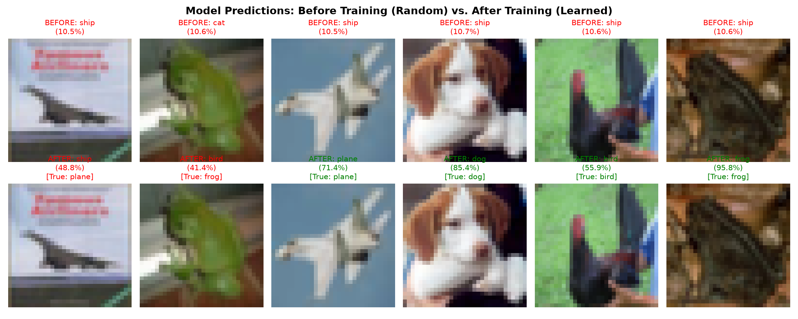
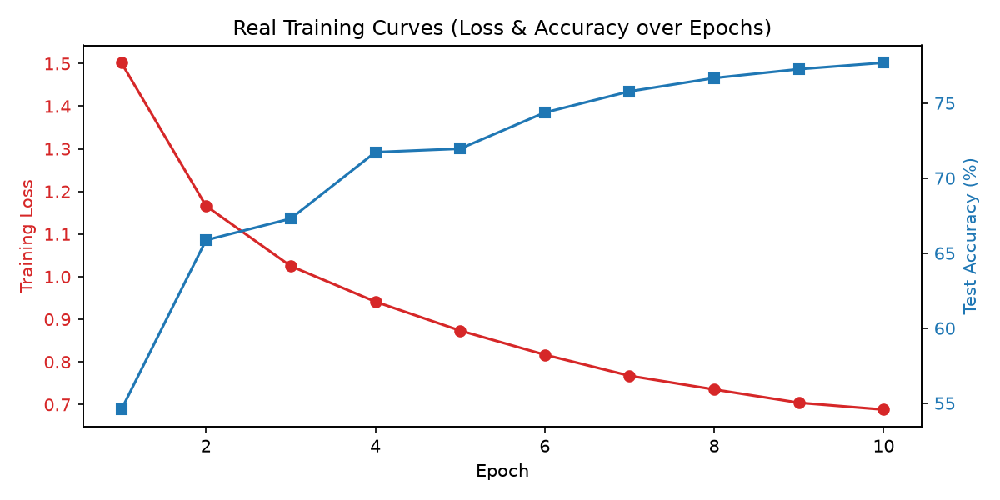

# Test 2: Real PyTorch Learning on AMD ROCm

Welcome to `test2`! Unlike `test1` (which used synthetic random noise and black-box wrappers), this suite focuses on **authentic PyTorch fundamentals**:
- Building a custom neural network from scratch with PyTorch (`nn.Module`).
- Loading a real-world dataset ([CIFAR-10](https://www.cs.toronto.edu/~kriz/cifar.html) — 60,000 real 32x32 photos across 10 classes).
- Writing the genuine PyTorch training loop (`zero_grad()`, `forward()`, `backward()`, `step()`).
- Demonstrating a dramatic **Before vs. After**:
  - **Before Training:** Random weights guess blindly (~10% accuracy, completely wrong predictions).
  - **After Training:** Weights learn visual features (~80% accuracy, confident correct predictions).
- Saving trained checkpoints (`cifar10_cnn.pt`) and visual comparison plots.

---

## Directory Structure

```
test2/
├── Dockerfile                  # Container with ROCm PyTorch, torchvision, matplotlib
├── run.sh                      # Build & launch script with ROCm device access
├── README.md                   # This guide
└── docker_data/                # Mounted to /app inside the container
    ├── train_cifar10.py        # [Main] Full training pipeline + Before/After evaluation
    ├── predict.py              # [Inference] Test random samples with confidence bars
    ├── data/                   # Auto-downloaded CIFAR-10 dataset
    ├── cifar10_cnn.pt          # Saved model weights (generated after training)
    ├── comparison_before_after.png  # Visual before/after grid (generated)
    └── training_curves.png     # Loss & accuracy progression plot (generated)
```

---

## How to Run

### Step 1: Launch the Docker Container
From your host terminal, run:
```bash
cd test2
./run.sh
```

### Step 2: Run Real Training & See Before vs After
Inside the container terminal:
```bash
python train_cifar10.py
```
What you will see:
1. **Device info**: Confirms AMD ROCm GPU detection and VRAM.
2. **Untrained check**: Tests 6 sample images before training. Random weights will guess incorrectly (e.g., guessing a cat is a ship with 10% confidence).
3. **Training on ROCm GPU**: 10 epochs with real loss descent and live accuracy updates.
4. **Trained check**: Tests the exact same 6 images after training. Predictions become accurate and highly confident!
5. **Comparison summary**: Prints a terminal comparison table and exports `comparison_before_after.png` and `training_curves.png`.

### Step 3: Run Interactive Predictions
Since the trained model checkpoint (`cifar10_cnn.pt`) is archived directly in this repository, you can inspect predictions immediately without having to re-train:
```bash
python predict.py
```

---

## Archived Results

### Before vs. After Training


### Training & Validation Curves


---

## Core PyTorch Concepts in this Test

1. **`torch.nn.Module`**:
   The backbone of PyTorch models. We construct layers (`Conv2d`, `BatchNorm2d`, `ReLU`, `MaxPool2d`, `Linear`) in `__init__` and connect them in `forward(x)`.

2. **The 5-Step Training Loop**:
   Every deep learning model in PyTorch follows these 5 fundamental steps:
   ```python
   optimizer.zero_grad()       # 1. Reset gradients from last step
   outputs = model(inputs)     # 2. Forward pass: compute predictions
   loss = criterion(outputs, targets)  # 3. Calculate loss / error
   loss.backward()             # 4. Backward pass: autograd computes gradients
   optimizer.step()            # 5. Gradient descent: update weights
   ```

3. **Inference vs Training Mode**:
   - `model.train()`: Enables dropout and batch norm tracking.
   - `model.eval()` + `with torch.no_grad()`: Disables gradient tracking to save VRAM and run fast predictions.

