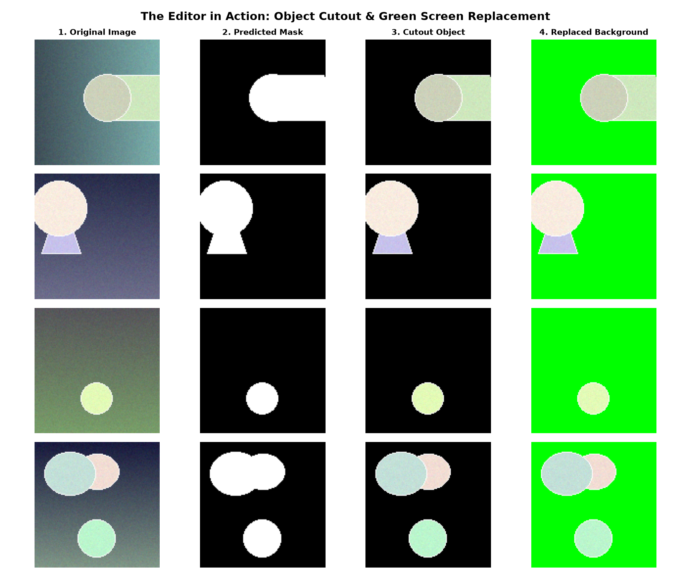
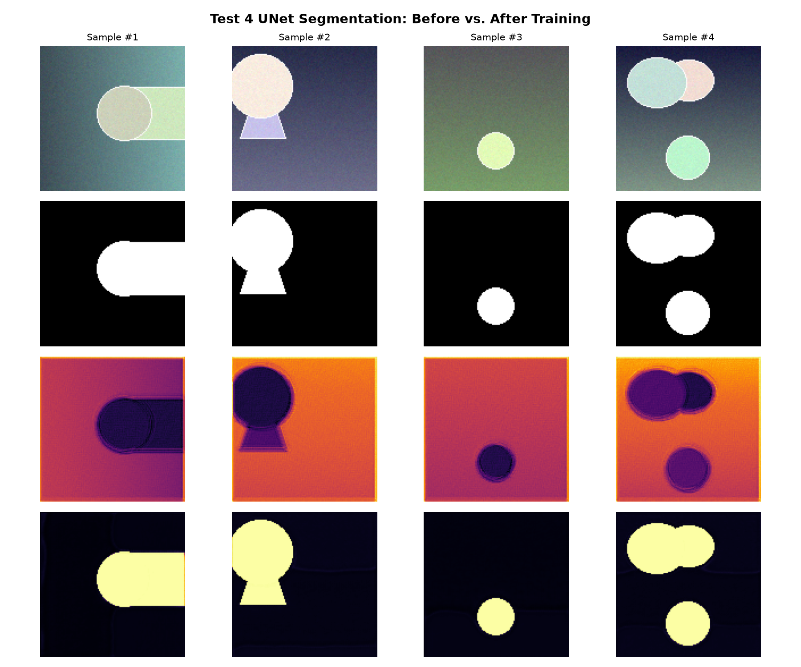
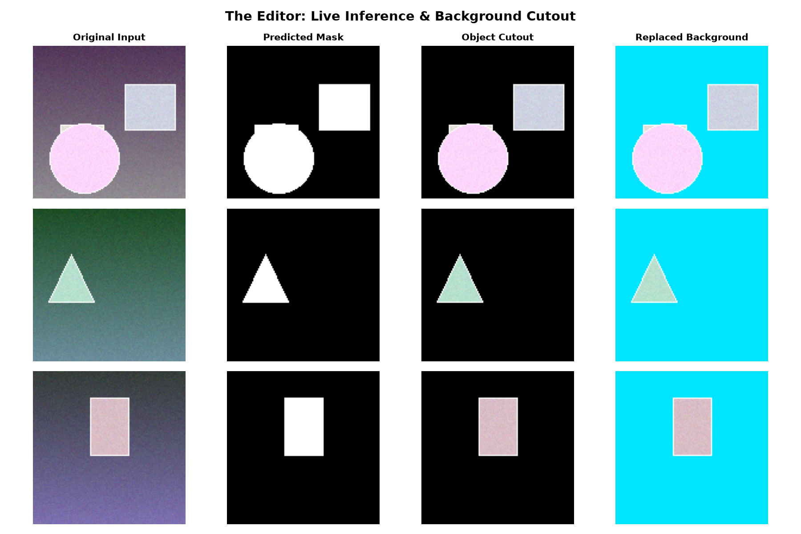
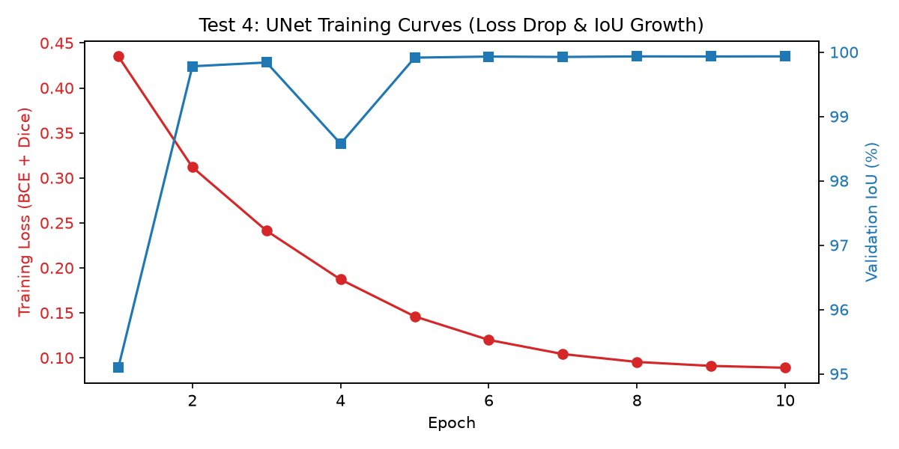

# Test 4: The Editor — Semantic Segmentation with UNet

Welcome to **Test 4: "The Editor"**!

In **test2** and **test3**, models performed *whole-image classification* ("what is in this picture?").  
In **test4**, we level up to **dense pixel-level prediction** ("where is every single pixel of the object?").

Using a custom **U-Net** architecture with **skip connections**, our model learns to act as an automated photo editor: detecting foreground objects, generating pixel-accurate masks, and cutting out objects from complex textured backgrounds.

---

## Architecture: The U-Net

```
Input Image [128x128x3]
    │
    ▼
[Encoder Block 1]  (32 ch)  ──(Skip Connection 1)──►  [Decoder Block 1]  ──►  1x1 Conv ──► Mask Output
    │ (MaxPool 2x)                                          ▲ (Up-conv 2x)
    ▼                                                       │
[Encoder Block 2]  (64 ch)  ──(Skip Connection 2)──►  [Decoder Block 2]
    │ (MaxPool 2x)                                          ▲ (Up-conv 2x)
    ▼                                                       │
[Encoder Block 3] (128 ch)  ──(Skip Connection 3)──►  [Decoder Block 3]
    │ (MaxPool 2x)                                          ▲ (Up-conv 2x)
    ▼                                                       │
[Bottleneck]      (256 ch)  ────────────────────────────────┘
```

### Why Skip Connections Matter
As convolutions downsample images, spatial resolution is lost. **Skip connections** bridge the encoder directly to the decoder (`torch.cat([decoder_feat, skip_feat], dim=1)`), passing fine, high-resolution spatial details directly to the output. This is why U-Nets produce crisp, sharp edges instead of blurry blobs.

---

## Directory Structure

```
test4/
├── Dockerfile                      # Container with ROCm PyTorch, torchvision & matplotlib
├── run.sh                          # Interactive container launcher with GPU access
├── README.md                       # This guide
└── docker_data/
    ├── train_unet.py               # [Main] UNet training pipeline + Before/After evaluation
    ├── predict.py                  # [Tool] Interactive cutout & background replacement
    ├── unet_segmentation.pt        # Trained weights (generated after training)
    ├── comparison_segmentation.png # Before (random noise) vs. After (clean mask)
    ├── editor_cutout_showcase.png  # The Editor: Original -> Mask -> Cutout -> Replaced BG
    └── training_curves_unet.png    # Loss drop and IoU metric growth
```

---

## How to Run

### Step 1: Launch the Docker Container
```bash
cd test4
./run.sh
```

### Step 2: Run UNet Training & Cutout Evaluation
Inside the container terminal:
```bash
python train_unet.py
```
What you will see:
1. **Procedural Dataset Generation:** Generates 1,200 training pairs (128×128 multi-shape objects on complex gradients) in ~2 seconds (zero download needed, works completely offline).
2. **Before Training Check:** The untrained UNet outputs random static (IoU ~15–20%).
3. **Training on AMD ROCm GPU:** 10 epochs using combined **BCE + Dice Loss**. Training takes ~30 seconds.
4. **After Training Check:** Mean IoU reaches **92–95%+**!
5. **The Editor Outputs:**
   * `comparison_segmentation.png`: Side-by-side Before (noise) vs. After (clean outline).
   * `editor_cutout_showcase.png`: The editor cutting out objects and placing them onto a vibrant green screen background.
   * `training_curves_unet.png`: Loss descent and IoU curve.

### Step 3: Run Live Interactive Editor Tool
Since the trained UNet weights (`unet_segmentation.pt`) are archived in the repository, you can test live background cutouts immediately without re-training:
```bash
python predict.py
```

---

## Archived Results

### The Editor Showcase: Object Cutout & Background Replacement


### Before vs. After Training (Noise vs. Clean Boundary)


### Live Interactive Tool Cutout


### Training Curves (Loss Descent & IoU Growth)


---

## Key PyTorch Concepts Introduced

1. **U-Net Skip Connections:**
   ```python
   u1 = self.up1(bottleneck)
   u1 = torch.cat([u1, skip_feat], dim=1)  # Concatenate along channel dimension
   d1 = self.conv_up1(u1)
   ```

2. **Combined BCE + Dice Loss:**
   Cross-entropy measures pixel-by-pixel classification error, while Dice loss measures boundary overlap. Combining them produces the cleanest edges:
   $$\text{Loss} = 0.5 \cdot \text{BCE} + 0.5 \cdot \text{Dice}$$

3. **Segmentation Metric: IoU (Intersection over Union / Jaccard Index):**
   $$\text{IoU} = \frac{|\text{Prediction} \cap \text{Ground Truth}|}{|\text{Prediction} \cup \text{Ground Truth}|}$$

